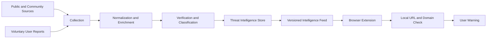

# ScamShield

### Privacy-First Online Scam Detection & Protection

> **Protect users without monitoring users.**

ScamShield is an independent cybersecurity research and development project exploring practical ways to help people identify and avoid online scams in Vietnam.

The project focuses on two connected areas: a responsibly curated threat-intelligence pipeline and privacy-preserving protection at the browser level. The long-term goal is to make trustworthy scam indicators easier to verify, distribute, and use—without turning user activity into a source of surveillance.

> [!IMPORTANT]
> **Project status: Research & Discovery.** ScamShield is an early-stage project. The architecture and capabilities described below are proposed directions, not a claim that a working product or production service already exists.

---

## The Problem

Online scams use a wide range of techniques, including phishing websites, impersonation, fake recruitment offers, fraudulent e-commerce pages, investment schemes, and malicious downloads.

People may encounter suspicious links through social networks, messaging applications, email, SMS, search results, or online advertisements. Warning information can be fragmented across platforms and organizations, while users often have to decide whether a link is safe on their own.

ScamShield is researching whether a transparent, regularly updated, and privacy-conscious approach to threat intelligence can make those decisions easier.

## Vision

Build an accessible layer of online scam protection that helps users make safer decisions while respecting their privacy, autonomy, and digital rights.

### Guiding objectives

- **Useful protection:** prioritize actionable URL and domain intelligence.
- **Privacy by design:** minimize data collection and process checks locally where practical.
- **Evidence-based intelligence:** distinguish unverified reports from corroborated and verified indicators.
- **Transparency:** explain why an indicator is considered risky and communicate uncertainty.
- **Accessibility:** design clear, understandable warnings for people with different levels of technical knowledge.
- **Responsible research:** respect source terms, data protection requirements, and platform security boundaries.

## Proposed Solution

ScamShield is exploring a two-part architecture.

### 1. Threat Intelligence Pipeline

A central pipeline would collect indicators from permitted public sources, official advisories, and voluntary community submissions. It would then:

1. Normalize URLs and domains.
2. Enrich and deduplicate indicators.
3. Evaluate source reliability and supporting evidence.
4. Classify indicators and assign confidence and verification status.
5. Store timestamps and expiration information.
6. Publish versioned threat-intelligence updates for supported clients.

Community submissions would **not** automatically become verified threats. Reports should pass validation and corroboration before being distributed as confirmed indicators.

### 2. Local Browser Protection

A proposed browser extension for supported desktop browsers (initially Chrome and Edge) would:

- Check a destination URL or domain against locally available threat intelligence.
- Display a clear warning when a known risky destination is detected.
- Use periodically updated intelligence, with local data available for checks when offline.
- Avoid collecting browsing history or sending users' visited URLs to a central server as part of routine checks.

The exact browser APIs, permission model, redirect handling, and technical limitations will be evaluated during prototyping.

## Privacy Principles

Privacy is a core design requirement, not an optional feature.

- No routine collection of browsing history.
- No default reading of chat, email, or page contents.
- No clipboard access.
- No collection of passwords, OTPs, or authentication secrets.
- No invasive monitoring of other applications.
- No bypassing application security controls or certificate protections.
- Threat intelligence is intended to flow from the service to clients; routine browsing activity should not flow back to the service.
- Any optional user-submitted evidence must be voluntary, clearly explained, and minimized.

For the full design rationale, see [Privacy Principles](docs/privacy-principles.md).

## Initial Scope

### In scope for the research and potential MVP

- URL and domain-based threat intelligence.
- Phishing and impersonation websites.
- Fake banking or public-service websites.
- Fraudulent recruitment and task-based websites.
- Suspicious e-commerce and investment destinations.
- A transparent verification and confidence model.
- A versioned feed for local client-side checks.
- A Chrome/Edge extension prototype.

### Out of scope for the initial phase

- Detecting or blocking scam phone calls and SMS.
- Direct monitoring of Zalo, Facebook, or other mobile in-app browsers.
- Reading private messages, email content, or other application data.
- Detecting every form of financial fraud or account compromise.
- Automated law-enforcement actions or financial-account intervention.
- Guaranteeing that every malicious or fraudulent website will be detected.

Protection will depend on supported browsers, available intelligence, and the technical capabilities of each platform. A browser extension cannot automatically protect links opened entirely inside unsupported applications or in-app browsers.

## Research & Discovery

The project begins with research before committing to a production architecture.

Current research areas include:

- **User research:** online habits, scam exposure, user decision-making, current protective tools, and privacy expectations.
- **Vietnam threat landscape:** scam patterns, available statistics, reporting channels, and emerging tactics.
- **Policy and public initiatives:** the roles of government agencies, financial institutions, telecommunications providers, and digital platforms.
- **Existing solutions:** capabilities, limitations, user experience, and privacy approaches of relevant tools.
- **Threat-intelligence sources:** coverage, freshness, reliability, licensing, attribution, and permitted use.
- **Technical feasibility:** browser extension APIs, local matching, feed distribution, update integrity, and operational cost.

Research findings should document their source, publication date, scope, methodology, and limitations. Survey results are exploratory unless a representative sampling method is established.

## High-Level Architecture (Proposed)

The following diagram represents a research concept, not an implemented system.



## Candidate Technology

Technology choices remain subject to research and proof-of-concept testing.

| Area | Candidate technologies |
|---|---|
| Data collection and validation | Python |
| Initial indicator storage | SQLite |
| Feed format | JSON with versioning and integrity verification |
| Browser client | Chrome/Edge Extension APIs (Manifest V3) |
| Source control and automation | GitHub, GitHub Actions |
| Potential feed hosting | Static hosting or an appropriately scoped serverless service |

No specific cloud provider or external intelligence source is a permanent dependency at this stage. Free-tier limits, acceptable-use policies, licensing, and sustainability must be reviewed before adoption.

## Roadmap

| Phase | Focus | Status |
|---|---|---|
| 0 | Research & Discovery: user needs, threat landscape, existing solutions, source evaluation | **In progress** |
| 1 | Requirements, threat model, architecture, and privacy review | Planned |
| 2 | Threat-intelligence collection and validation prototype | Planned |
| 3 | Local URL matching and browser extension prototype | Planned |
| 4 | Testing, measurement, usability evaluation, and iteration | Planned |

The roadmap is intentionally iterative. Scope and priorities may change as evidence is collected.

## Repository Structure

```text
ScamShield/
├── README.md
├── CONTRIBUTING.md
├── docs/
│   ├── product-vision.md
│   ├── privacy-principles.md
│   └── roadmap.md
├── research/
│   ├── market-research/
│   ├── user-research/
│   └── competitor-analysis/
└── threat-intelligence/
    └── data-sources.md
```

## Research Integrity & Data Handling

- Do not publish personal information collected during research.
- Store and publish survey findings in aggregated or appropriately anonymized form.
- Do not include raw personal submissions, credentials, OTPs, or private communications in the repository.
- Respect the terms and licenses of external datasets and services.
- Preserve source links and record the date accessed where relevant.
- Clearly label assumptions, estimates, unverified reports, and known limitations.

## Contributing

ScamShield is currently an early-stage independent project. Research feedback, carefully sourced documentation, responsible testing, and constructive technical discussion are welcome.

Please read [CONTRIBUTING.md](CONTRIBUTING.md) before proposing changes. Do not submit private personal data or live harmful payloads.

## Disclaimer

ScamShield is a research and development project, not a substitute for official reporting channels, professional security tools, or careful user judgment. No detection system can guarantee complete protection. False positives and false negatives are possible.

Do not use this project to access, test, or interfere with systems without authorization.

## License

A license has not yet been selected. Until a license is added, no general permission to reuse, modify, or redistribute this repository should be assumed. External datasets and third-party materials remain subject to their own terms.

---

**ScamShield — Chung tay xây dựng không gian mạng an toàn, vì một Việt Nam văn minh và tốt đẹp hơn.**
